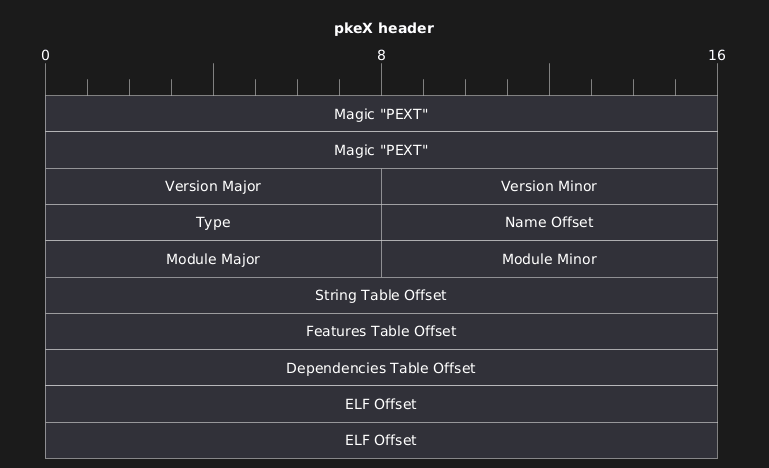
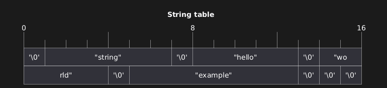
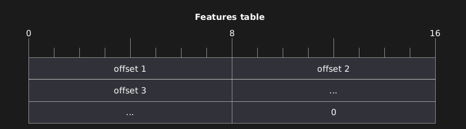
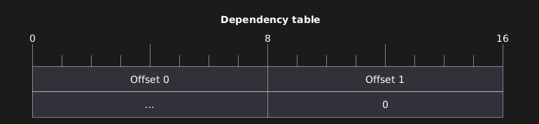

# pkeX specification
## Revision 0.1 (November 2026)
The **p**urple**k**2 **eX**tensions (pkeX, *pee-kex*) system is an interface designed to let the purplek2 kernel load modules and manage their relations between them.

# Goal
The main goal of this interface is to give the necessary information to the kernel to load a certain module file code at the kernel-level and to manage eventual dependencies between them.

## Features

To properly manage the dependencies side of modules, our solution is to let each module declare features that it offers, and declare which they require too.

# Components
The main components for this interface are the pkeX module files (pkeXs, *pee-kexes*) and the module manager.

## pkeX files
pkeX files are the data that contain the code that enables software extensions or device drivers.
They are ELF shared objects (`e_type = DYN`) of which only kernel-code functions should be relocated. The ELF header and file is preceded by pkeX-specific data of variable length.

## Module manager
The module manager is a kernel-level components that is responsible for choosing the source for loading modules, (eg. bootloader parameters, somewhere on the disk through a specific path).

It is also responsible for avoiding modules, on which others are relying on, to be unloaded to avoid issues when calling potentially unavailable code.

The manager is responsible for finding, through the dependency list, which modules should be loaded too to satisfy the dependencies.
It is also responsible for satisfying a specific type of dependencies: **CPU architecture**, as the module may offer extensions that are compatible only on certain CPUs (eg. APIC driver).

# pkeX file format
A pkeX file, excluding the ELF data, is composed of a fixed-size header and at least two tables of variable length.

## pkeX header
The header contains the basic information about the module needed by the manager. It is found at the start of the file.

- **Magic**: a signature for the module format. This MUST be equal to the string `PEXT`. If not, this is an invalid file.
- **Version**: Identifies the pkeX specification revision. Higher 8 bits identify the major version, lower 8 for the minor.
- **Type**: Identifies the module type. Currently supported types are: `PKEX_MOD` (0, offers a software extension), `PKEX_DRV` (1, offers a device driver).
- **Name**: This is an offset into the String table (see [String Table](#)) that tells the name of this driver.
- **Module Major & Minor**: Identifies the version of this module, useful for modules that rely on others. Higher 8 bits for major, lower 8 for minor.
- **String Table Offset**: Offset into the file for the String table (see [String Table](#string-table) below). Not to be confused with ELF's string table.
- **Features Table Offset**: Offset into the file for the Features table (see [Features Table](#) below).
- **Dependencies Table Offset**: Offset into the file for the Dependencies table (see [Dependencies Table](#) below).
- **ELF Offset**: Offset into the file for the start of the ELF file to be executed.

## String table

The string table is a 16-bit aligned section, at least 16 bits large. It starts and ends with a `NUL` character (`\0`). It contains zero-terminated character sequences.

## Features table

This table tells which features this module offers. It can be divided into 8-bit entries that are offsets into the string table that refer to the name of this module's features. A module MUST declare at least one feature, and MUST be terminated with an entry with value `0`, so the table is at least 16-bits large.

## Dependency Table

This table tells which features this module requires. It's made of 8-bit entries, each giving an offset into the string table for the name of the required feature. The table is terminated with an entry of value 0. There can be no dependencies, which means this table only has the null entry.

